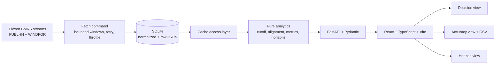

# Architecture

## System map

## Data flow

1. `python -m app.data.fetch_data` requests FUELHH by settlement-date ranges
   with `fuelType=WIND`, and WINDFOR by six-hour publication windows from
   2025-12-15 through the end of January 2026.
2. The Elexon stream responses are JSON arrays without page tokens. The client
   bounds response size with date windows, limits request frequency, and retries
   transient HTTP/network errors. The cache upserts normalized query columns and
   preserves each raw response record as JSON in SQLite.
3. API reads use only the local cache. Startup checks data coverage and reports
   an empty cache; it does not call Elexon.
4. Analytics chooses the latest row whose `publishTime` is no later than the
   delivery-day cutoff. Cutoff calculations use `Europe/London`, then return an
   aware UTC instant for comparison with API timestamps.
5. Live January data has hourly WINDFOR targets and half-hourly FUELHH actuals.
   The analytics layer averages both half-hour actuals to the matching hour.
   Incomplete hours are dropped; forecast points are not interpolated.
6. Accuracy and horizon APIs compute errors from those paired, selected
   observations. The decision API derives signed P10/P90 error by horizon and
   reverses the sign to produce plausible actual-generation bounds around the
   forecast.

## Key decisions and tradeoffs

- **SQLite over a remote database:** the dataset is a small, fixed historical
  slice; local persistence keeps request paths deterministic and removes live
  source dependency. A production host must ship or mount a prefetched cache.
- **Bounded stream windows rather than pagination:** the documented stream
  routes return arrays rather than paginated envelopes. Six-hour WINDFOR
  windows manage payloads; the `(startTime, publishTime)` key prevents
  overlap duplicates from changing results.
- **UTC storage, London decision clock:** UTC avoids ambiguous data comparisons;
  local decision rules are explicit and DST-aware.
- **D-1 09:00 default:** this is an operational assumption, not a published
  gate closure. UI and API expose both hour and minute so users can test their
  own decision time.
- **No half-hour interpolation:** the observed WINDFOR target cadence is
  hourly. Averaging two actual intervals provides a consistent hourly error
  measure without inventing forecast values.
- **Signed error convention:** `forecast - actual`; positive bias is an
  over-forecast. For actual plausible range, forecast minus P90 error is the
  lower bound and forecast minus P10 error is the upper bound.
- **Explicit missingness:** missing pairs do not become zero error. MAPE omits
  actuals below 1 MW, and all-missing metrics are `null`.
- **One-month evidence:** error quantiles and horizon comparisons are
  illustrative only; they are not probabilistic guarantees.

## API surface

The FastAPI app exposes `/api/health`, `/api/meta`, `/api/actuals`,
`/api/forecast/latest`, `/api/compare`, `/api/metrics`, and
`/api/metrics/by-horizon`. Pydantic response models define the API contract.
The browser's API origin is configured with `VITE_API_BASE_URL`.

## Deployment shape

The Vite frontend is configured for static deployment on Vercel. The backend
uses the provided Dockerfile and Render blueprint and bundles the prefetched
SQLite cache. Rebuild the image to publish refreshed data; the backend does
not fetch from Elexon at startup.
